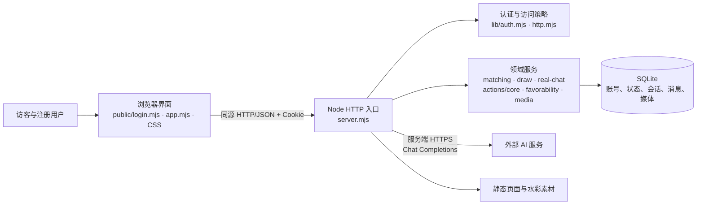
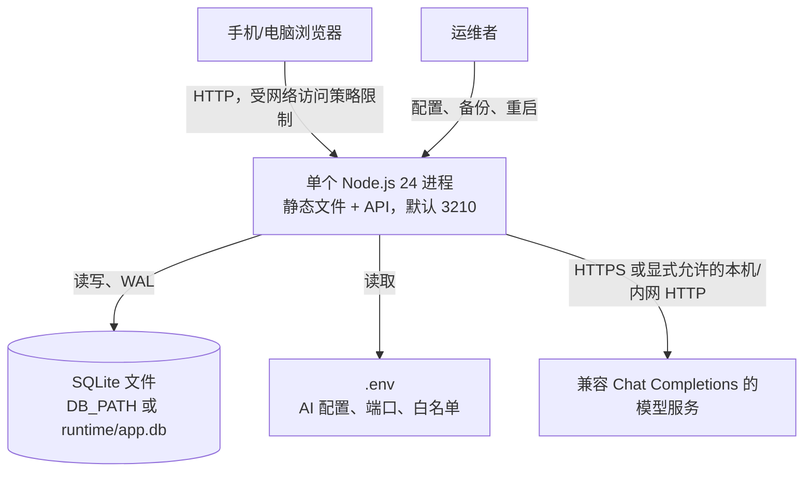
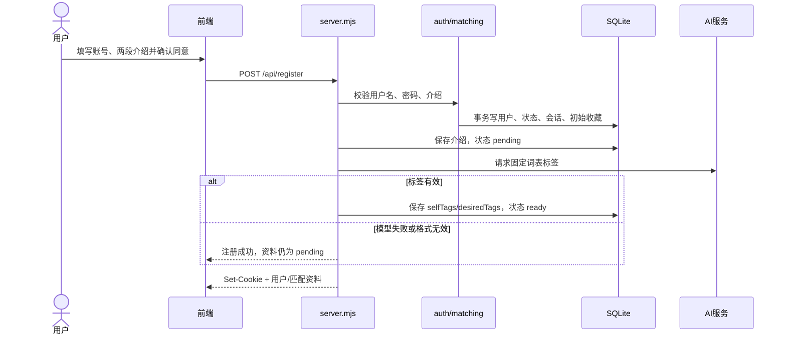
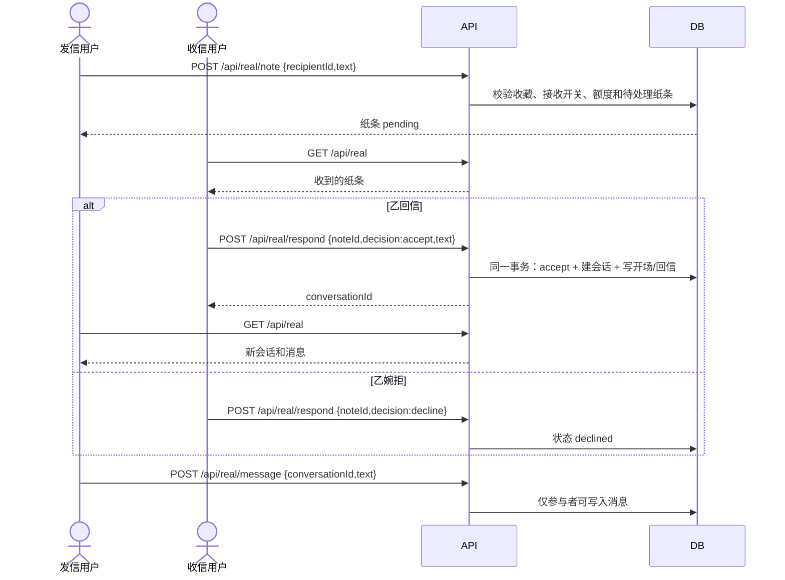
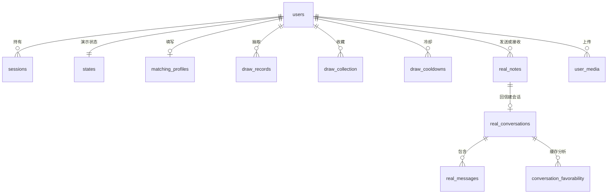

# 《谁能打开你的窗》软件设计文档

**架构设计与系统设计｜个人实验成果**

| 项目 | 内容 |
|---|---|
| 作者 | 王羽喆 |
| 日期 | 2026-10-12 |
| 文档版本 | 1.1（根据第 1 次提交反馈修订） |
| 设计对象 | `who_will_open_your_window` Web 应用 |
| 对照代码 | 本地 `main` 提交 `8a09943`（以提交时实际代码为准） |
| 交付格式 | Markdown，单文件，可直接提交 |

## 1. 范围、依据与需求基线

### 1.1 核心问题与边界

陌生人交友的初次交流常面临三个问题：不知道与谁开始、难以组织第一句话、对含糊话语容易过度解读。本系统通过自述标签匹配与抽卡、纸条和对话、可编辑的 AI 建议来降低开场成本。系统也提供明确标注的虚拟人物，用于演示交流流程。真人消息只能由真人本人发送；AI 的意图和好感度结论是基于有限文本的参考分析，不能作为对方真实心理或承诺的证明。

本设计覆盖**当前课程演示版**：单实例 Node.js 服务、SQLite 存储、浏览器前端和一个兼容 Chat Completions 的外部模型接口。目标用户是访客、已注册用户；运维者通过服务端配置、数据库备份和日志管理系统，没有独立管理员网页。AI 虚拟人物是系统资源，不是注册用户。支付、身份核验、真实内容审核、找回密码与生产级公网运营不在范围内。

### 1.2 需求来源与变更说明

本次**沿用用户提供的实验 1 需求文档作为原始基线**：`提交包-需求分析实验.zip` 内《需求分析文档 ——「谁能打开你的窗」轻量社交互动 Demo》v1.0（2026-09-28）的 `FR-01`～`FR-35`、`NFR-01`～`NFR-12` 与约束 `C1`～`C5`。后文引用原需求时保持这些编号不变。由于现有项目在实验 1 后有较大扩展，新增需求独立编号 `ADD-F01`～`ADD-F12`、`ADD-N01`～`ADD-N07`；变更项目、原因及影响列于第 12 章，原需求编号对照列于第 11 章。原文在提交包内可逐字核对，不将新增需求伪装成原文需求。

原基线聚焦单机浏览器、三位 AI 虚拟人物、纸条、私人心笺和七天周期。本版将注册用户、真人匹配与聊天、SQLite 持久化加入范围。保留的规则和改动的规则均在第 11–12 章显式标记。新增的非功能数值目标在 ADD-N01–ADD-N07 中标为待验证，不将其写成已完成的实测结果。

### 1.3 本版新增与扩展的功能需求

优先级 P0 表示本版核心链路，P1 表示增强功能。所有功能均以已登录用户为业务主体，另有注明者除外。

| 编号 | 优先级 | 可验收的需求 |
|---|---|---|
| ADD-F01 | P0 | 访客可用用户名、密码和两段介绍注册；用户名忽略大小写唯一，重复时给出明确提示；用户可登录、退出，同账号仅保留一台设备的有效会话。 |
| ADD-F02 | P0 | 用户可编辑自我介绍与期望对象介绍，明确同意展示和模型分析；系统从固定词表提取本人及期望标签，失败时保留介绍并允许重试。 |
| ADD-F03 | P0 | 系统用双方标签计算契合度，符合阈值者与虚拟人物进入相遇候选池；用户可抽卡、喜欢收藏或跳过，收藏上限为 5，跳过/移除有 30 天冷却，测试阶段同日可多次抽取。 |
| ADD-F04 | P0 | 用户收藏真人后可递纸条；收件人可回信开启双方对话或婉拒；双方只能读写自己参与的纸条、会话和消息。 |
| ADD-F05 | P0 | 用户可与明确标注的虚拟人物按演示规则递纸条、发送消息，由 AI 生成虚拟人物回复；已发送内容在回复失败时保留且可重试。 |
| ADD-F06 | P1 | 拾言针对对方最近一句话给出三种可能解释及相对权重、三条可编辑回复建议；分析期间用户仍可手动输入和发送。 |
| ADD-F07 | P1 | 真人对话可查看基于回复速度、连续性、字数占比和可用时的 AI 内容分析形成的参考好感度；任一方关闭好感度系统后对外隐藏相关结果。 |
| ADD-F08 | P1 | 用户可上传/删除个人形象与场景背景；双方有权查看时显示形象，未上传时显示占位形象；自定义背景失败可重载。 |
| ADD-F09 | P1 | 虚拟人物演示允许记录仅自己可见的心笺，按周期回望、授权并确认演示性的双向意愿；演示操作不冒充真人判断。 |
| ADD-F10 | P1 | 用户可在手机与电脑查看遇见、纸条、对话、我的；对话显示发送时间，真人新消息在页面可见时自动同步，未发送草稿尽量保留。 |
| ADD-F11 | P0 | 用户可控制是否接收陌生人纸条；系统限制真人纸条额度和重复待处理纸条，并拒绝未获收藏资格的首次联系。 |
| ADD-F12 | P0 | 运维者可配置模型地址、模型名、密钥、端口、访问策略和数据库位置；密钥仅在服务端使用，不返回浏览器。 |

### 1.4 本版新增与扩展的非功能需求及验收目标

下列数值是**设计验收目标**，不是声称当前已完成的实测性能。

| 编号 | 维度 | 设计要求与可度量目标 |
|---|---|---|
| ADD-N01 | 性能 | 在单机、100 个账号及每会话 1,000 条消息的测试数据下，非 AI 的常用读接口 p95 < 300 ms；模型请求单次超时 35 s，并限制同时进行的模型相关请求为 4。 |
| ADD-N02 | 可靠性 | 单次请求失败不得产生半张纸条或半个会话；数据库备份可通过完整性检查，恢复演练能读出账号、收藏和消息；模型不可用时真人聊天继续可用。 |
| ADD-N03 | 安全 | 每个受保护接口都需会话和对象级授权；口令只存加盐哈希，会话只存令牌哈希；秘密不进入静态资源、API 响应和 Git；跨站 JSON 写请求拒绝。 |
| ADD-N04 | 隐私 | 匹配结果不泄露他人的期望描述、私人心笺和授权状态；好感度双向开关受服务端校验；模型只获得完成具体分析所需的有界文本。 |
| ADD-N05 | 易用性 | 320 px 宽手机和 1440 px 宽桌面无横向溢出；键盘可完成主要操作；减少动态效果时可跳过入场和抽卡动画；错误提示说明下一步。 |
| ADD-N06 | 可维护性 | 业务规则不散落在页面事件里；数据库迁移可重复启动；关键规则有自动化测试；设计中列出的接口与实际实现保持一致。 |
| ADD-N07 | 可扩展性 | 新增虚拟人物或分析因子不应要求改动账号、会话核心表结构；当前容量以单实例为边界，多实例须先重新设计写入和请求并发控制。 |

### 1.5 术语与假设

“真人”指系统注册账号；“虚拟人物”指由系统设定并由模型生成回复的演示角色；“拾言”指对话理解和回复建议；“收藏”指抽中后主动保留的联系资格；“私人心笺”是用户自评，和真人对话的算法好感度是不同数据。时间戳统一存 Unix 毫秒。抽卡的日历边界按北京时间；真人纸条现有额度按服务端本地自然日计算，部署时应设置 `Asia/Shanghai` 并在跨时区运行测试中核对。

## 2. 架构设计

### 2.1 分层与依赖



浏览器只保存当前交互状态和待发送草稿，不是数据真相。入口负责路由、身份验证、同源检查、限流与响应格式；领域模块负责规则和对象授权；`lib/db.mjs` 建表与启动迁移，SQLite 是账号、抽卡、真人聊天和演示状态的持久化真相。模型调用仅由入口使用服务端配置发起，浏览器拿不到密钥。依赖方向为“界面 → HTTP 入口 → 领域模块 → 数据库”；`public/core.mjs` 提供可在服务端复用的演示规则，服务端写入仍以 `lib/actions.mjs` 白名单为门禁。

#### 架构约束清单

以下约束可直接作为实现审查与测试的判定标准，无须把文件名的存在视为证明：① 浏览器只能通过同源 API 读写业务数据，不获得数据库连接或模型密钥；② 受保护路由必须先认证，再以当前用户核验对象关系，客户端传入的 userId 不能替代认证身份；③ 客户端只能提交白名单动作，禁止上传完整演示状态，禁止外部执行 finishReply；④ 真人消息的发送者来自会话身份，模型输出只进入虚拟回复或分析结果；⑤ 网络模型调用期间不得持有 SQLite 写事务；⑥ 多表状态变化必须原子提交，唯一索引负责最后一道并发约束。对应需求为 ADD-N02/03/04、FR-14/15/20、NFR-05/07/11。

### 2.2 部署与运行视图



浏览器启动后读取 `/api/me`、`/api/draw` 和 `/api/real`。用户操作经 JSON API 到达单个 Node 进程；SQLite 使用 WAL 与外键，部分跨表操作使用事务；页面可见时约每 6 s 轮询真人消息及遇见状态。模型响应时间不确定，调用最长 35 s，前端请求最长 45 s。部署前应备份数据库，启动后运行迁移并检查 `/api/status` 与登录后的关键页面。默认监听本机；配置 `ALLOW_LAN` 或 `ALLOW_IPS` 才允许其他设备访问。当前 HTTP 适合受控实验网络；面向不受信任网络必须先加 HTTPS 与安全 Cookie。

### 2.3 运行时状态

演示人物的纸条、对话、私人心笺、授权和模拟时间以 `states.json` 存储；真人纸条、会话、消息以关系表存储。两条路线在“对话”界面汇合，但身份、写入接口、模型权限和隐私规则始终分开。抽卡的待决定结果在服务端保存，刷新页面不会重新随机；`like/skip` 决定后才能再次抽取。

## 3. 模块设计

| 模块 | 边界与主要职责 | 直接依赖 / 不负责 |
|---|---|---|
| `public/login.mjs`、`public/app.mjs`、`public/api.mjs` | 注册登录、四个导航页、抽卡动画、纸条与 Galgame 对话、状态渲染、草稿与错误处理；统一封装 GET/POST 和 401 跳转。 | 依赖 HTTP API；不持有数据库连接或模型密钥。 |
| `server.mjs` | 静态白名单、配置读取、会话入口、路由、模型请求编排、统一错误响应与同时请求上限。 | 依赖领域模块；不把客户端上传的完整状态作为真相。 |
| `lib/auth.mjs` | 注册、scrypt 密码校验、单设备会话、失效/顶替、登录失败限流。 | 依赖数据库与默认状态；不决定抽卡或聊天内容。 |
| `lib/matching.mjs` | 介绍校验、固定标签词表、模型输出校验、双向契合度。 | 由入口调用模型；不负责随机抽取。 |
| `lib/draw.mjs` | 候选池、按契合度加权抽取、待决定结果、收藏上限、冷却、旧人物初始化。 | 依赖匹配资料、状态及 SQLite；不处理聊天正文。 |
| `lib/real-chat.mjs` | 真人纸条额度、收件处理、建会话、发消息、列表快照、头像查看资格。 | 依赖抽卡收藏资格；不生成真人回复。 |
| `public/core.mjs` + `lib/actions.mjs` + `lib/state.mjs` | 虚拟人物规则和有效状态、允许的动作、用户演示状态持久化。 | `finishReply` 只允许服务端内部调用。 |
| `lib/favorability.mjs` | 真人对话的规则因子、模型结果解析、组合评分与缓存读取、双方隐私开关判定。 | 不判断用户真实心理；模型失败时可使用规则因子。 |
| `lib/media.mjs` | 图片格式/大小校验、存取个人形象和背景。 | 图片字节在 SQLite，不发给模型。 |
| `lib/db.mjs` | 模式、索引、外键、旧抽卡表迁移和初始收藏补齐。 | 不决定 HTTP 响应。 |

关键内聚点：匹配分数只在 `matching.mjs` 计算，抽卡状态只在 `draw.mjs` 变更，真人消息只在 `real-chat.mjs` 写入。入口对好感度分析仍含编排逻辑，若规模增加可抽为应用服务，但本版不增加框架或消息队列。

## 4. 关键流程设计

### 4.1 注册、标签提取与匹配（ADD-F01、ADD-F02、ADD-F03）



正常路径中，用户名按不区分大小写的唯一索引检查；模型只能从固定词表各取 1–8 个无重复标签。用户改介绍后标签重置为 `pending`，旧标签不继续参与新抽卡。分支：模型不可用仍保留账号和介绍，可用 `/api/match-retry` 重试；如果资料在模型响应期间被再次编辑，旧响应不得覆盖新资料。异常：无效或重复用户名返回 400/409；重复字符、长度不合规或无同意不进入建号流程；模型格式问题只影响标签生成，不回滚已注册账号。双向分数要求双方期望均命中对方本人标签，取两个命中比例的平均并四舍五入；为 0 或低于 60 不入候选池。

### 4.2 相遇抽卡与收藏（ADD-F03、ADD-F11）

1. 前端 `GET /api/draw` 取得 `collection`、唯一 `pending`、`canDraw` 和不可抽原因。系统对旧账号只补一次初始三位演示人物，不补回被移除的人。
2. 用户抽卡时，服务端核验标签 `ready`、收藏少于 5、候选池非空。候选排除自己、已收藏、冷却中、不可收纸条的真人、已有真人对话或待回应纸条者。候选契合度至少 60，按分数作为权重随机选择，事务内写入 `draw_records.pending`。
3. 刷新或重复抽卡请求直接取回同一待决定结果。用户选 `like` 时将快照写入收藏；选 `skip` 时写入 30 天冷却；两种操作均把结果标为已决定。相同 `drawId` 的重复决定不重复写入。
4. 收藏满员不能继续抽，用户可移除一位后再抽；移除写入 30 天冷却，但已有纸条和会话不删除。测试版取消了每日次数上限，页面中的“今日相遇”是界面名称，不代表每日限次。

抽卡数据库事务和 `draw_one_pending` 唯一索引共同保证同账号并发请求只留下一个未决定结果。空池、资料未完成和满员均以明确原因返回，不消耗机会。金/紫/蓝分别对应 95–100、85–94、60–84 的标签契合度，不能解释为感情成功概率。

### 4.3 真人纸条到对话（ADD-F04、ADD-F10、ADD-F11）



纸条 1–100 字；真人对话消息 1–500 字。发送前核验发送者已收藏对方、对方允许陌生人纸条、双方尚无对话、双方没有待处理纸条，以及发送者当天未超过两张。对话建立后可直接发消息，不再重复递纸条。收信人只能处理寄给自己的 `pending` 纸条。客户端约 6 s 轮询已登录用户的真人快照，时间戳来自服务端；网络失败保留输入草稿并提示重试。模型不参与真人消息发送。

### 4.4 虚拟人物回复、拾言与好感度（ADD-F05、ADD-F06、ADD-F07、ADD-F09）

虚拟人物纸条/消息经 `POST /api/action` 白名单写入演示状态并设置待回复标记；`POST /api/reply` 用服务端保存的最近最多 16 条对话组装模型请求。回复成功后，服务端内部执行 `finishReply`；如果用户在等待期间屏蔽了人物或待回复状态消失，旧模型结果不写回。失败时保留已发消息和待回复标记，允许重试。

拾言在收到对方消息后调用 `POST /api/guidance`，服务端验证该消息仍是可分析的最近对方消息，返回恰好三条意图及相对权重（总和 100）和三条回复建议。建议只填入编辑框，用户确认后才发送；分析中只禁用重复分析，不锁住手动发送。若新消息到达，旧分析只绑定旧 `messageId`，不能冒充新消息结论。

真人好感度读取先检查本人和对方开关。双方都开启时，规则因子为回复速度、连续交流、字数占比；若模型可用，再分析最近最多 20 条消息。四因子存在时各占 25%；没有有效模型结果时规则因子分别占 35%、35%、30%。结果缓存以会话、目标用户和最后消息 ID 为依据，消息变动后重新计算。模型失败时降级为规则结果；任一方关闭开关时返回 `canView:false`，不显示缓存值。显示文案必须标注为“参考分析”，不能作为真实好感或关系承诺。

### 4.5 媒体、会话失效与恢复（ADD-F01、ADD-F08、ADD-F10）

图片上传前端转为 data URL；服务端核验 PNG/JPEG/WebP 实际内容及头像 2 MB、背景 3 MB 上限后写 `user_media`。背景仅自己可取；头像仅自己、符合抽卡/收藏/纸条/会话授权条件者可取。页面用更新版本参数加载图片，失败时提供“重新加载背景”；未上传用问号占位。另一设备登录时旧会话被标记失效；旧浏览器下一次请求收到 `SESSION_REPLACED`，尽力保存未发草稿并跳到登录页。草稿只是本机暂存，不等同于服务端已发送消息。

### 4.6 跨模块状态迁移约束

| 对象 / 当前状态 | 事件与前置条件 | 目标状态 / 原子变化 | 禁止路径与失败后状态 |
|---|---|---|---|
| 真人纸条 pending | 收件人 accept，回信合规 | accepted + 唯一会话 + 开场/回信两条消息，同一事务提交 | 非收件人、重复处理拒绝；事务失败仍 pending，无半会话。 |
| 真人纸条 pending | 收件人 decline | declined，记录处理时间 | accepted/declined 不可再次处理，不创建会话。 |
| 抽卡无 pending | 资料 ready、收藏 <5、候选非空，draw | 新 pending 快照 | 条件不符不写记录；重复 draw 返回现有 pending。 |
| 抽卡 pending | 本人 like / skip | liked + 收藏，或 skipped + 冷却 | 他人不可决定；重复决定不产生第二次变化。 |
| 虚拟人物可发送 | sendMessage / sendNote | 保存用户内容并建立 pending 任务 | 已有 pending 或屏蔽时拒绝。 |
| 虚拟人物 pending | 有效模型回复，pending 仍存在 | 写入回复、解除 pending | 模型失败仍 pending；等待期间屏蔽后，迟到结果不写入。 |
| 好感度可见缓存 | 双方开启且缓存 last_message_id 等于当前最后消息 ID | 返回缓存及其 updatedAt | 消息 ID 改变则缓存失效；新结果写回最后消息 ID。 |
| 好感度缓存任意 | 任一方关闭开关 | 返回 canView:false，隐藏评分 | 不能因为存在旧缓存而跳过开关核验。 |

好感度缓存写入发生在分析完成后，键为会话与目标用户；缓存只代表该次所读取的消息快照。分析期间有新消息到达时，写入的 last_message_id 仍属于旧快照，下一次读取按 ID 不一致识别过期；updatedAt 不等同于消息最新时间。上述迁移对应 ADD-F03/04/05/07、FR-13/14、ADD-N02/04。

## 5. 接口设计

### 5.1 通用 HTTP 约定

所有业务 API 位于 `/api/*`，请求体为 `application/json`；`GET` 不带请求体。除 `GET /api/status`、注册和登录外均需 `hw_session` Cookie。服务器核验 TCP 客户端 IP（若设白名单）、Host、Origin、`Sec-Fetch-Site`；默认 JSON 请求上限 64,000 字节，媒体接口上限 4,200,000 字节。模型调用与 `/api/action` 共享当前进程的 4 个并发名额。业务响应为 JSON，成功使用 200；失败统一为 `{"error":"中文提示","code":"机器可读代码"}`。常用状态：400 `INVALID_INPUT`、401 `UNAUTHENTICATED/SESSION_REPLACED`、403 `FORBIDDEN/NOT_COLLECTED`、404 `NOT_FOUND`、409 `USERNAME_TAKEN/COLLECTION_FULL`、422 `INTRO_TOO_VAGUE`、429 `RATE_LIMITED/BUSY`、502 `FORMAT/NETWORK/TIMEOUT/UPSTREAM`、503 `NOT_CONFIGURED`。具体接口只返回其触发的子集。

### 5.2 浏览器到服务器的业务接口

表中 `→` 后列出关键响应字段；对象 ID 均为服务器创建的字符串，时间为 Unix 毫秒。所有参数仍由服务端再次校验，不能仅依赖界面禁用按钮。

| 方法与路径 | 输入 | 成功输出 | 调用限制与错误 |
|---|---|---|---|
| `POST /api/register` | `{username,password,selfIntro,desiredIntro,shareForMatching:true}` | `{user,matchingProfile}`，并设置会话 Cookie。 | 用户名 3–20 位字母/数字/下划线，密码 8–128 字；介绍各 10–500 字。重复名 409；模型失败可注册、标签留 pending。 |
| `POST /api/login` / `POST /api/logout` | `{username,password}` | `{user,replacedDevice}`；退出 → `{ok:true}`。 | 失败的账号/IP 分别计数，达到阈值 15 分钟限流；重新登录顶替旧会话。 |
| `GET /api/me` | 无参数 | `{user,state,matchingProfile,media,aiAvailable}`。 | 仅本人；不含密码哈希、盐和模型密钥。 |
| `POST /api/match-profile` / `POST /api/match-retry` | 保存：`{selfIntro,desiredIntro,shareForMatching:true}`；重试：`{}` | `{matchingProfile,aiAvailable,matchingError}`。 | 标签未 ready 时不得参与新抽卡；模型格式或连接异常保留介绍。 |
| `GET /api/draw` / `POST /api/draw` | 读或抽 | `{canDraw,reason,capacity,collection,pending,unlimited}`。 | `pending` 存在则复用；满 5、空池或资料未就绪不可新抽。 |
| `POST /api/draw/decision` | `{drawId,decision:"like"\|"skip"}` | 更新后的抽卡状态。 | 只能决定自己的抽卡，重复决定幂等；喜欢时重查容量。 |
| `POST /api/draw/remove` | `{kind:"real"\|"virtual",personId}` | 更新后的抽卡状态。 | 移除后 30 天冷却，已有聊天保留。 |
| `GET /api/matches` | 无参数 | `{matches:[已收藏的真人卡片]}`。 | 这是收藏视图，不是原始候选池；不返回他人的期望介绍。 |
| `GET /api/real` | 无参数 | `{notes,conversations}`；会话含最近 50 条消息。 | 只返回本人参与的记录；纸条最多最近 100 张、会话最多最近 50 个。 |
| `POST /api/real/note` | `{recipientId,text}` | 更新后的真人快照。 | 已收藏、对方接收、每天最多两张、同对无待处理纸条。 |
| `POST /api/real/respond` | `{noteId,decision:"accept"\|"decline",text?}` | `{conversationId,notes,conversations}`。 | 仅收件人；接受时回信 1–100 字；婉拒时 `conversationId:null`。 |
| `POST /api/real/message` | `{conversationId,text}` | 更新后的真人快照。 | 仅会话双方，正文 1–500 字。 |
| `POST /api/action` | `{type,...}` | `{state,result}`。 | `type` 限 `sendNote/sendMessage/startNoteReply/incomingAction/blockPerson/injectNote/review/confirmHeart/recordFeeling/saveScenario/saveProfile/advance/reset`；`finishReply` 仅内部调用。 |
| `POST /api/reply` | `{personId,context?}` | `{state,text}`。 | 仅有效虚拟人物和有资格的待回复状态；模型并发与超时限制；客户端伪造的完整历史不采信。 |
| `POST /api/suggestions` | `{personId,intent?,draft?,messages?}` | `{suggestions:[{label,text}]}`。 | 恰好 3 条，每条文本不超过 100 字；草稿仅供生成，不自动发送。 |
| `POST /api/guidance` | 虚拟：`{personId,messageId}`；真人：`{conversationId,messageId}` | `{messageId,interpretations,suggestions}`。 | 最近消息 ID 不符返回 400；真人历史从服务端查询且需会话成员。 |
| `GET /api/real/favorability?conversationId=...` | 无请求体 | `{canView,targetName,score?,tier?,factors?,updatedAt?}`。 | 任一方关闭则 `canView:false`；仅会话双方可查。 |
| `POST /api/real/favorability/analyze` | `{conversationId}` | 含 `canView`、评分及因子或关闭原因。 | 模型最多分析最近 20 条；模型失败用规则因子；未参与会话 404。 |
| `POST /api/favorability/toggle` | `{enabled:boolean}` | `{favorabilityEnabled}`。 | 只改本人开关；关闭后双方视图即时隐藏。 |
| `POST /api/media` | `{action:"save"\|"delete",kind:"avatar"\|"background",data?}` | `{media}`。 | data URL；服务端核验格式、字节和本人身份。 |
| `GET /api/media/background` / `GET /api/media/avatar/:userId` | 无参数 | 图片字节及 MIME。 | 背景只给本人；头像按推荐/收藏/纸条/会话关系授权，越权返回 404。 |
| `GET /api/status` | 无参数 | `{app,version}`。 | 仅健康信号，不保证模型或数据库业务完全可用。 |

示例：真人回信成功返回的 `conversationId` 可用于后续 `/api/real/message`，其 `messages[].role` 对当前用户而言，自己的消息为 `user`，对方消息为 `assistant`。这个字段仅是客户端对话渲染角色，不表示真人消息由 AI 发出。

### 5.3 内部接口与第三方接口

| 接口 | 输入 → 输出 | 错误、调用限制与边界 |
|---|---|---|
| `openDatabase(filename)` | SQLite 文件路径 → `DatabaseSync` | 启动建表与迁移；迁移失败回滚并阻止启动。 |
| `register/login/resolveSession(db,...)` | 凭据或 Cookie → 用户、令牌或失效原因 | 唯一索引与事务维护单设备会话；调用方不得返回敏感列。 |
| `saveMatchingProfile/storeTags/matchScore` | 介绍/标签对象 → 保存状态/整数分数 | 标签必须取自固定词表；零单向命中时分数为 0。 |
| `drawState/draw/decide/remove(db,userId,...)` | 用户 ID、决定 → 抽卡快照 | 事务和唯一待决定索引保证并发一致性。 |
| `sendRealNote/respondRealNote/sendRealMessage` | 已认证 userId 与业务 ID/正文 → ID 或写入结果 | 对象级授权、长度和状态校验；接受纸条需原子创建会话。 |
| `runAction(db,user,type,body,...)` | 白名单动作 → 新演示状态、结果 | 原型链名称拒绝；`finishReply` 必须 `internal:true`。 |
| `calculateReplySpeed/calculateContinuity/calculateWordRatio/composeFavorabilityScore` | 真人消息数组与目标用户 → 指标/综合分 | 无消息提供中性基线；分数截断 0–100；只是启发式指标。 |
| 外部 `POST {AI_BASE_URL}/chat/completions` | `Authorization: Bearer {AI_API_KEY}`；`{model,messages,stream:false}` → `choices[0].message.content` 字符串 | 服务端调用、35 s 超时、最多 4 个同时的模型相关请求；解析失败转 `FORMAT`，401/403/429/网络失败映射为受控错误。 |

模型接口只假定兼容非流式 Chat Completions，不假定它提供向量检索、函数调用或结构化输出保证。输出 JSON 由本系统自行解析和校验；匹配、拾言、好感度分析使用不同提示模板和最少必要上下文。密钥写于服务器 `.env`，不得进入前端、提交仓库或错误响应。

### 5.4 外部模型契约测试边界

契约测试以可替换 fetchImpl 的模拟上游执行，不调用真实密钥。每项同时断言错误码、无无效业务写入、无上游原文或秘密回显；只有真实服务商通过相同请求/响应契约后，才可判定该服务商兼容。

| 编号 | 模拟上游响应 / 注入内容 | 必须检查的结果 |
|---|---|---|
| CT01 | 200，choices[0].message.content 为非空字符串 | 原样取得 trim 后文本；业务解析器另行校验格式。 |
| CT02 | 无 choices、空数组、content=null/对象/数组/空串/全空白 | 502 FORMAT，不展示残缺建议，不完成虚拟 pending。 |
| CT03 | content 长度 12,000 与 12,001（UTF-16 code unit） | 前者通过传输层长度检查，后者 FORMAT；前者仍需通过业务 JSON 校验。 |
| CT04 | 200 但响应体非 JSON；或 content 为无法解析的 JSON | 分别在传输层/业务层拒绝为 FORMAT。 |
| CT05 | 建议 2/4 条、空标签、标签超 12、文本超 100；意图权重小数/越界/总和非 100 | 业务解析器拒绝；合规的恰好 3 条及权重总和 100 通过。 |
| CT06 | HTTP 401/403、429、500；连接拒绝、超时 | 分别映射 AUTH、RATE_LIMIT、UPSTREAM、NETWORK、TIMEOUT；虚拟消息保留，参考分析按既定降级路径处理。 |
| CT07 | 上游重定向、恶意指令夹在聊天文本中 | 重定向不跟随；提示词把聊天作为数据，响应继续经过格式校验，不能改变身份与写入权限。 |

CT07 的提示词检查只证明防护机制存在，不证明模型永远抵抗提示注入。合同测试的可执行入口为第 13.3 节中的 server.test.mjs、matching.test.mjs、favorability.test.mjs；CT01–CT07 是完整验收清单，未覆盖的边界需增补用例后才能标记通过。

## 6. 数据设计

### 6.1 实体关系与存储分工



关系表存身份、资料、抽卡、真人交互和媒体；`states.json` 存虚拟人物演示内部状态。前端 `ui` 状态、动画、回复选项和当前草稿不作为服务端业务真相。两类聊天均显示 `at` 时间，但真人消息由 `real_messages` 表提供，虚拟人物消息来自 `states.json`；二者不混写。

### 6.2 关键实体与字段

| 表 / 结构 | 关键字段、格式与约束 | 用途 |
|---|---|---|
| `users` | `id TEXT PK`；`username TEXT UNIQUE COLLATE NOCASE`；`password_hash/salt TEXT NOT NULL`；`name` ≤20、`habit/topic` 各 ≤100 字；`allow_notes/favorability_enabled INTEGER`（0/1 语义）；`created_at INTEGER`。 | 账号及唯一的公开资料/隐私开关真相；字段长度对应 FR-03、CH-03，账号与隐私开关对应 ADD-F01/07/11。 |
| `sessions` | `token_hash TEXT PK`、`user_id FK`、`device`、`expires_at`、`active`、`replaced_by`；部分唯一索引保证每个用户至多一行 `active=1`。 | 单设备登录，固定 30 天有效期。原始令牌只在 Cookie。 |
| `states` | `user_id PK/FK`、`json TEXT`、`updated_at`。JSON 有 `notes/messages/pending/feelings/reviews/confirmations/scenarios/blocked/offsetDays` 等。 | 虚拟人物的演示状态；读时结构校验，用户资料从 `users` 注入，不重复保存在 JSON。 |
| `matching_profiles` | `user_id PK/FK`；`self_intro/desired_intro` 各 10–500 字；`self_tags/desired_tags` 为 JSON 字符串数组，每组 1–8 个固定标签；`status pending/ready`；`updated_at`。 | 标签匹配输入与状态。更改介绍后清空旧标签并转 pending。 |
| `draw_records` | `id PK`、`user_id FK`、`day YYYY-MM-DD`、`kind real/virtual`、`person_id`、`snapshot JSON`、`status pending/liked/skipped`、`created_at`；每用户最多一条 pending 的部分唯一索引。 | 记录抽取结果及幂等恢复。测试阶段 `day` 留作审计字段，不实施每日唯一约束。 |
| `draw_collection` / `draw_cooldowns` | 收藏联合主键 `(user_id,kind,person_id)`，含快照与加入时间；冷却同联合主键并含 `until_at`。容量 5、冷却 30 天由领域规则验证。 | 联系资格与跳过/移除后的候选排除。 |
| `draw_onboarding` | `user_id PK/FK`。 | 标记初始三位人物已补入，防止删除收藏后重启又补回。 |
| `real_notes` | `id PK`、发信/收信用户 FK、`body`、`status pending/accepted/declined`、创建/处理时间；对同一有向用户对仅允许一条 pending 的部分唯一索引。 | 真人开场与收件处理。双向待处理检查另由业务规则执行。 |
| `real_conversations` | `id PK`、按 ID 排序的 `user_a/user_b FK`、唯一 `note_id FK`、创建/更新时间；`UNIQUE(user_a,user_b)`。 | 一对用户唯一会话。 |
| `real_messages` | 自增 `id INTEGER PK`、`conversation_id/sender_id FK`、`body`、`created_at`；会话+ID 降序索引。 | 真人消息。发送者必须是会话成员，靠服务端检查。 |
| `conversation_favorability` | 联合主键 `(conversation_id,target_user_id)`；`score INTEGER`、`factors JSON`、`last_message_id`、`updated_at`。 | 参考分析缓存；任一方关闭开关时即使有缓存也不返回评分。 |
| `user_media` | 联合主键 `(user_id,kind)`；`kind avatar/background`、`mime`、`bytes BLOB`、`updated_at`。 | 上传图片与版本标记。 |
| `login_attempts` | `key PK`、`failures`、`first_at`。 | 用户名/IP 双维度限流。 |

关系约束由 SQLite 外键、唯一索引和枚举 CHECK 完成；文本字符数、候选资格、收藏容量、隐私授权等复杂规则由领域服务检查。数据库文件不进入 Git，`.env` 与备份也不进入静态文件白名单。归档备份包含真人消息和口令哈希，应仅由运维者保管。

### 6.3 一致性、迁移与时间

- 注册写用户、初始演示状态、会话与初始收藏使用事务；真人回信将纸条变为 accepted、创建会话并写开场/回信放在同一事务；抽卡、决定、移除均用 `BEGIN IMMEDIATE`。失败回滚，避免半完成状态。
- `draw_one_pending` 防止并发抽出多张未决定卡；`sessions_one_active` 防止同账号双设备同时有效；`UNIQUE(user_a,user_b)` 防重复真人会话。API 层在唯一索引之外还提供易懂的错误说明。
- 模型分析发生在数据库写入之外：介绍先保存为 pending，模型返回有效标签后写 ready；虚拟人物的用户消息先落库，回复失败保留 pending；好感度模型失败降级为规则因子。不能跨模型网络调用持有长期 SQLite 写事务。
- 启动迁移会补齐新字段、旧抽卡表结构和初始收藏标记；迁移前备份数据库，失败时回滚并停止启动。WAL 与外键在每次打开数据库时启用。
- 抽卡日历用北京时间；会话、图片和消息时间存 Unix 毫秒。页面按用户浏览器本地时间显示日期与发送时间。真人纸条日额度在当前实现中按服务器本地日期判断，因此部署配置与跨时区测试必须保证预期一致。

## 7. 界面与交互设计

| 使用者 / 页面 | 主要元素与状态 | 设计约束 |
|---|---|---|
| 访客：登录/注册 | 用户名、密码、两段介绍、展示与 AI 分析同意；重复用户名和无效介绍就地提示。 | 不展示任何已登录账号数据；登录被顶替时说明原因。 |
| 注册用户：遇见 | 抽卡、可跳过动画的结果、金紫蓝参考契合度、5 格收藏栏、初始虚拟人物；真人/AI 身份显式区分。 | 未决定卡刷新后恢复；满员、空池、资料 pending 时说明原因；喜欢才取得新对象联系资格。 |
| 注册用户：纸条 | 真人纸条与虚拟人物演示分区；来信可回信或婉拒，演示来信另有暂存/归档。 | 真实消息和预设来信必须清晰标记；不展示已读回执。 |
| 注册用户：对话 | 背景和人物立绘、底部对白、最近消息时间、三条 AI 建议和“自己输入”；历史记录可回看。 | AI 正在判断时仍可编辑/发送；建议只填草稿；真人头像缺失显示问号，消息约每 6 s 同步。 |
| 注册用户：我的 | 公开资料、匹配资料、媒体设置、陌生人纸条开关、好感度开关；演示心笺/回望与重置。 | 私人心笺和参考好感度分区，关闭好感度时双方不可查看对应评分。 |
| 运维者 | 没有管理员网页；通过 `.env`、日志、数据库备份和启动命令操作。 | 密钥不经浏览器交互，不暴露调试接口。 |

手机以 390 px 为主，兼容 320 px 窄屏；电脑在 1440 px 使用侧栏与主区。键盘焦点应在重绘后尽量恢复；减少动态效果时跳过入场和抽卡动画；长文可滚动、不横向溢出。上传背景失败不影响发消息，可使用默认背景并重试。按钮不可用时给出原因，避免仅靠颜色表达状态。

## 8. 非功能设计与验证指标

| 需求 | 设计手段 | 验证方法及目标 |
|---|---|---|
| ADD-N01 性能 | SQLite 主键/会话索引、最近消息分页式截取（当前快照最近 50 条）、6 s 可见页轮询、模型 35 s 超时和最多 4 个同时的模型相关请求。 | 制造 100 账号/每会话 1,000 消息的数据集，压测非 AI 读接口 p95 < 300 ms；第五个并发模型请求返回 429；超时在 35 s 左右结束。该 p95 尚需实测。 |
| ADD-N02 可靠性 | SQLite 事务、唯一索引、WAL、迁移回滚、备份；模型失败的 pending/降级路径。 | 故障注入回信中断/抽卡重试，无半会话或重复 pending；对备份运行 `PRAGMA integrity_check` 并实际恢复演练。 |
| ADD-N03 安全 | scrypt 加盐哈希、令牌哈希、单设备会话；同源/Host/IP 校验、CSP、静态白名单、对象授权和受控错误。 | 越权调用所有真人对象接口得到 401/403/404，`/.env` 不可读，前端包和 API 不含密钥；登录失败达到阈值触发 429。 |
| ADD-N04 隐私 | 标签匹配只展示自述与共同标签；心笺不入模型；好感度读取前重新查双方开关；模型上下文限制。 | 伪造上游捕获请求体，断言不含心笺、他人期望描述、授权；关闭任一方开关后 GET/POST 好感度均不返回分数。 |
| ADD-N05 易用性 | 响应式布局、显式真人/AI 标识、中文错误和恢复入口、键盘焦点恢复、减少动画。 | 浏览器在 320/390/1440 px 检查无横向滚动与操作阻塞；仅键盘完成注册、抽卡、发消息；减少动画设置下无强制等待。 |
| ADD-N06 可维护性 | 领域模块按职责划分、动作白名单、固定 AI 输出校验、无第三方运行时依赖、独立测试。 | `npm test`、浏览器用例和 `git diff --check` 通过；新增角色仅扩展人物配置与对应测试。 |
| ADD-N07 可扩展性 | 抽卡候选统一为 `kind/id` 卡片快照，新增虚拟人物无需改真人会话表；好感度因子合成集中于模块。 | 增加一个测试人物或一个模拟因子时，账号/会话模式不用修改；多实例部署前必须设计跨进程写锁和模型并发配额。 |

这些指标是本次设计的验收目标。项目现有自动化测试可以证明部分规则正确，但不能替代真实模型兼容性测试、长期负载测试或生产网络安全审计。

## 9. 异常、故障与恢复设计

| 故障模式 | 检测与服务端处理 | 界面与恢复路径 | 对应需求 |
|---|---|---|---|
| 用户名重复、凭据错误或登录暴力尝试 | 唯一索引返回 409 `USERNAME_TAKEN`；登录失败按账号/IP 计数，阈值后 429，密码错误不透露账号是否存在。 | 表单给出中文提示；用户更换用户名或稍后重试。 | ADD-F01、ADD-N03 |
| 会话过期或被另一设备顶替 | `resolveSession` 返回 401 `UNAUTHENTICATED/SESSION_REPLACED`，不执行写操作。 | 保留未发送草稿的尽力尝试，跳转登录页并说明顶替原因；重新登录后取服务端状态。 | ADD-F01、ADD-F10 |
| 模型未配置、鉴权失败、超时、限流或格式错误 | `NOT_CONFIGURED/AUTH/TIMEOUT/RATE_LIMIT/FORMAT`；35 s 超时，恰当映射为 503/502；不保存无效生成内容。 | 匹配介绍保持 pending 并可重试；虚拟回复保持待回复且不重发用户消息；真人聊天继续可用；好感度降级为规则指标。 | FR-11～FR-16、NFR-01、ADD-F02、ADD-F05、ADD-F07 |
| 抽卡请求重复或网络断开 | 事务写入、每用户唯一 pending、按 drawId 决定。 | 重新 GET 可恢复同一结果；不能在未决定前抽下一张；重复决定不增加收藏。 | ADD-F03、ADD-N02 |
| 收件人重复回信或同时发信 | 仅 pending 可处理、会话唯一键、接受时同一事务写会话及两条消息；失败回滚。 | 刷新真人纸条/会话列表后重试；不会出现半会话。 | ADD-F04、ADD-F11、ADD-N02 |
| 越权读取头像、纸条、会话或好感度 | 服务端按当前用户、收藏或会话关系核验；未授权拒绝，媒体可返回 404 隐藏资源存在性。 | 页面显示无权限或对象不可用，不显示私人内容。 | ADD-F04、ADD-F07、ADD-F08、ADD-N03、ADD-N04 |
| 双方关闭好感度开关 | 每次读取及分析前重查双方设置，返回 `canView:false`，不返回缓存分数。 | 显示关闭原因与开启入口；不在 UI 留旧分数。 | ADD-F07、ADD-N04 |
| 图片格式、大小不合规或加载失败 | 服务端依据内容校验 MIME、大小，失败不覆盖已存图片。 | 显示默认背景/问号形象；可重新上传或重载背景。 | ADD-F08、ADD-N05 |
| SQLite 数据损坏、迁移失败或磁盘写入失败 | 打开数据库时建表/迁移事务回滚；状态 JSON 校验失败时拒绝渲染，返回受控错误；启动前备份。 | 运维者从经完整性校验的备份恢复，重启并回归关键接口；不以空白新状态覆盖坏数据。 | FR-32、NFR-11、ADD-N02 |
| 旧版 HTTP 部署暴露会话 Cookie | 本版识别为部署边界：默认本机，局域网/Tailscale 实验需受信任网络与白名单。 | 进入公网生产前加 TLS 和 `Secure` Cookie，再做安全复测。 | C1、C5、ADD-N03 |

当服务不可用时浏览器 API 封装在 45 s 内给出网络/超时提示，未成功的表单文本留在编辑框。服务端错误响应不回显模型原文、密钥、SQL 或内部堆栈。备份与恢复属于运维操作，恢复后要验证账号、收藏、真人消息和媒体可读，而不能只看健康接口。

## 10. 设计决策与权衡

| 决策 | 采用方案与原因 | 备选方案及未采用原因 | 代价 / 重新评估条件 |
|---|---|---|---|
| 数据真相 | 单实例 Node.js + SQLite；可在课程规模内用事务、外键、索引保证原子性，无运行时数据库服务。 | 浏览器 localStorage 无法支持真人多设备及对象授权；独立数据库服务器增加部署成本。 | 并发写或多实例增长时需改为独立 DB，并重新设计锁、迁移和连接管理。 |
| 匹配算法 | 模型仅从固定词表提标签，双向命中比例定量算分，再按分数加权抽卡。 | 直接让模型自由给两人打分：结果不稳定、难复现且难验证；向量检索对小候选池过重。 | 固定词表覆盖有限，分数只供参考；词表修改需版本化和重提标签。 |
| 真人与虚拟人物分开 | 真人走关系表和成员授权，虚拟人物走演示状态与模型回复，UI 显式标识。 | 统一为一张消息表/同一个发送接口：易混淆 AI 与真人身份，并放大权限风险。 | 前端需处理两套快照；换来明确的责任与隐私边界。 |
| 通知 | 页面可见时约 6 s 轮询。 | WebSocket 可更实时，但需要连接管理、重连、跨进程广播；课程单实例中收益有限。 | 最长存在数秒延迟与多次读取；活跃用户数增加时评估推送。 |
| 模型接入 | 服务端代理非流式 Chat Completions，限定密钥来源、超时、并发和 JSON 输出校验。 | 浏览器直连会暴露密钥；绑定某厂商私有 SDK 降低可替换性。 | 仍依赖第三方协议兼容性；新服务商必须做真实互通测试。 |
| 媒体保存 | 小尺寸图片以 BLOB 存 SQLite，随数据库备份并按用户授权读取。 | 文件系统散放简单，但事务、迁移和备份容易与数据库不同步；对象存储对实验过重。 | 大量图片会膨胀数据库，超过课程规模时迁移对象存储。 |
| 好感度表达 | 规则因子 + 可选模型内容因子，保留关闭开关和参考说明。 | 纯模型分数难以解释且断网不可用；把分数当作真实心理会误导用户。 | 启发式指标仍可能产生偏差，不能用于自动决策或公开排名。 |
| 安全边界 | 当前受控网络运行，默认本机监听；同源、Host/IP 与会话对象授权。 | 直接当作公网生产服务缺少 TLS、身份核验和审核。 | 对公开服务必须增加 HTTPS、安全 Cookie、审核与账号恢复等能力。 |

上述选择服务于实验规模，不以引入微服务、消息队列或复杂前端框架作为目标。

## 11. 需求追溯矩阵

“实验 1 原编号”一列沿用提供文件的原编号；新增项只用 `ADD-` 前缀。此表指向本设计章节和现有测试载体；状态为“调整”者必须结合第 12 章阅读。原始需求的完整措辞以提供的实验 1 文档第 4、5 章为准。

### 11.1 实验 1 功能需求

| 原编号 | 原需求主题 / 本版状态 | 设计元素 | 验证依据 |
|---|---|---|---|
| FR-01 | 三位虚拟人物及标识；调整为保留初始三位并增加抽卡人物 | 2.3、3 人物规则、7 遇见 | `core.test.mjs`、`draw.test.mjs`、视觉浏览器测试 |
| FR-02 | 人物资料卡；保留 | 3 前端、7 遇见/资料 | `browser.mjs`、视觉浏览器测试 |
| FR-03 | 可编辑演示身份；长度和存储位置调整 | 5 `/api/action saveProfile`、6 `users`、7 我的 | `actions.test.mjs`、`state.test.mjs` |
| FR-04 | 纸条必填且至多 100 字；保留 | 4.3、5 纸条接口、6 `real_notes/states` | `core.test.mjs`、`real-chat.test.mjs` |
| FR-05 | 虚拟人物每日两位新对象；额度保留，日界时区调整 | 1.5、3 `core/actions`、4.4、6 `states` | `core.test.mjs`、`actions.test.mjs`、跨时区用例 |
| FR-06 | 虚拟纸条重复限制；保留并扩展真人限制 | 4.3/4.4、5、6 | `core.test.mjs`、`real-chat.test.mjs` |
| FR-07 | 待回复且不显示已读；保留 | 4.3/4.4、7 纸条 | `core.test.mjs`、`browser.mjs` |
| FR-08 | 拾言三条纸条建议；保留 | 4.4、5 `/api/suggestions` | `server.test.mjs`、`browser.mjs` |
| FR-09 | 建议只填编辑框；保留 | 4.4、7 对话/纸条 | `browser.mjs` |
| FR-10 | 不编造/格式校验/边界建议；保留 | 5 模型接口、3 入口、9 模型错误 | `server.test.mjs` |
| FR-11 | AI 不可用时虚拟互动关闭；调整为真人交流继续可用 | 4.4、5、9 模型故障 | `server.test.mjs`、`real-browser.mjs` |
| FR-12 | 虚拟人物 AI 回应；保留 | 4.4、5 `/api/reply`、6 `states` | `core.test.mjs`、`browser.mjs` |
| FR-13 | 同人物一个待回复；保留 | 3 `core/actions`、4.4 | `core.test.mjs` |
| FR-14 | 失败保留与幂等重试；保留 | 4.4、9 模型故障 | `core.test.mjs`、`browser.mjs` |
| FR-15 | 最多 16 条及私人数据隔离；保留 | 4.4、5 第三方接口、8 隐私 | `server.test.mjs` |
| FR-16 | 虚拟人物安全提示；保留 | 5 模型请求模板 | `server.test.mjs` 与提示词走查 |
| FR-17 | 明确标注的预设来信；保留 | 3 `core/actions`、7 纸条 | `core.test.mjs`、`browser.mjs` |
| FR-18 | 收件回复/暂存/归档；保留在演示流程 | 3 `actions`、5 `/api/action`、6 `states` | `core.test.mjs` |
| FR-19 | 私人心笺分数/备注；保留 | 3 `actions`、6 `states`、7 我的 | `actions.test.mjs`、`core.test.mjs` |
| FR-20 | 心笺不影响意愿/不发模型；保留 | 4.4、5 模型边界、8 隐私 | `core.test.mjs`、`server.test.mjs` |
| FR-21 | 七天周期；起点改为服务端账号演示状态初始化 | 3 `core/state`、6 `states` | `core.test.mjs`、`state.test.mjs` |
| FR-22 | 当期意愿与授权；保留演示规则 | 3 `core/actions`、6 `states` | `core.test.mjs` |
| FR-23 | 轻叩前置条件；保留演示规则 | 3 `core/actions`、4.4、7 我的 | `core.test.mjs` |
| FR-24 | 双向结果不泄露私分；保留演示规则 | 3 `core/actions`、6 `states` | `core.test.mjs`、`browser.mjs` |
| FR-25 | 周期内一次且不可用不扣机会；保留 | 3 `core`、6 `states` | `core.test.mjs` |
| FR-26 | 跨周期授权失效；保留 | 3 `core`、4.4 | `core.test.mjs` |
| FR-27 | 屏蔽、撤销授权、停止互动；保留演示规则 | 3 `core/actions`、9 | `core.test.mjs` |
| FR-28 | 举报只说明边界；保留 | 7 界面与交互 | `browser.mjs` 文案走查 |
| FR-29 | 管理员配置模型；移除用户可见配置细节 | 2.2、5 第三方接口、7 运维者 | `server.test.mjs`、静态资源检查 |
| FR-30 | 原“检查连接”按钮；改为真实业务调用与状态提示 | 5 模型接口、9 模型故障、12 变更 | `server.test.mjs`、`browser.mjs` |
| FR-31 | 演示人物当期状态面板；保留 | 3 `core/actions`、7 我的 | `core.test.mjs`、`browser.mjs` |
| FR-32 | localStorage 持久化；改为账号隔离的 SQLite | 2.3、6 全部实体、9 数据故障 | `db.test.mjs`、`state.test.mjs` |
| FR-33 | 二次确认重置；现只重置虚拟演示状态 | 3 `actions`、6 `states`、7 我的 | `actions.test.mjs`、`browser.mjs` |
| FR-34 | 演示时间推进；保留 | 3 `core/actions`、6 `states` | `core.test.mjs` |
| FR-35 | 草稿仅页内；扩展为失效前尽力暂存 | 3 前端、4.5、9 会话故障 | `browser.mjs` |

### 11.2 实验 1 非功能需求与本版扩展需求

| 编号 | 主题 / 状态 | 设计元素 | 验证依据 |
|---|---|---|---|
| NFR-01 | 模型 35 s 超时；保留 | 2.2、5 外部接口、9 | `server.test.mjs` |
| NFR-02 | 同时模型相关请求最多 4；保留 | 3 入口、5、8 | `server.test.mjs` |
| NFR-03 | 64 KB 业务 JSON 与上下文上限；媒体另设 4.2 MB | 5 通用约定/媒体、8 | `server.test.mjs`、`media.test.mjs` |
| NFR-04 | 密钥不前传；状态响应不再返回模型名 | 2.1、5 `/api/me`、8 安全 | `server.test.mjs` |
| NFR-05 | 静态白名单及同源；允许显式配置的 LAN | 2.2、5 通用约定、8 安全 | `server.test.mjs` |
| NFR-06 | CSP、安全头与禁缓存；保留，图片有受限缓存 | 5 HTTP 约定、8 | `server.test.mjs`、浏览器 CSP 检查 |
| NFR-07 | 私人信息不送模型；本地存储改服务端授权存储 | 3、5、6、8 隐私 | `server.test.mjs`、`real-chat.test.mjs` |
| NFR-08 | 320/390/1440 宽度；保留 | 7、8 易用性 | `visual-browser.mjs` |
| NFR-09 | 清楚的中文错误与禁用原因；保留 | 5 错误约定、7、9 | `browser.mjs` |
| NFR-10 | 原 Windows supervisor；跨平台运行改以服务重启/健康检查为主 | 2.2、9 运维故障、12 变更 | 启动/重启/备份恢复演练 |
| NFR-11 | 状态结构校验；保留，迁移旧人物槽位 | 3 `state`、6、9 | `state.test.mjs` |
| NFR-12 | 无第三方运行时依赖与独立测试；保留 | 2.1、3、8 | `package.json`、`npm test` |
| ADD-F01 | 账号和单设备会话 | 3 `auth`、4.1、5、6 | `auth.test.mjs` |
| ADD-F02 | 介绍、AI 标签、重试 | 3 `matching`、4.1、5、6 | `matching.test.mjs` |
| ADD-F03 | 双向匹配、抽卡和收藏 | 3 `draw`、4.2、5、6 | `draw.test.mjs`、`draw-browser.mjs` |
| ADD-F04 | 真人纸条与对话 | 3 `real-chat`、4.3、5、6 | `real-chat.test.mjs`、`real-browser.mjs` |
| ADD-F05 | 当前虚拟人物路线 | 3 `core/actions`、4.4、5、6 | `core.test.mjs`、`browser.mjs` |
| ADD-F06 | 对话判断、可编辑建议 | 4.4、5 `/api/guidance`、7 | `server.test.mjs`、`real-browser.mjs` |
| ADD-F07 | 真人好感度参考分析与双向开关 | 3 `favorability`、4.4、5、6 | `favorability.test.mjs` |
| ADD-F08 | 上传头像和背景 | 3 `media`、4.5、5、6 | `media.test.mjs`、`visual-browser.mjs` |
| ADD-F09 | 私人心笺与周期演示 | 3 `core`、4.4、6、7 | `core.test.mjs` |
| ADD-F10 | 响应式对话、时间与同步 | 2.2、4.3、7 | `browser.mjs`、`real-browser.mjs` |
| ADD-F11 | 真人联系资格与限制 | 3 `real-chat`、4.3、6 | `real-chat.test.mjs` |
| ADD-F12 | 服务端配置和密钥 | 2.2、5、8 | `server.test.mjs` |
| ADD-N01 | 性能目标与模型上限 | 2.2、5、8 | 负载测试计划与 `server.test.mjs` |
| ADD-N02 | 事务、备份和降级 | 4、6、8、9 | 故障注入与恢复演练 |
| ADD-N03 | 登录及对象级安全 | 2、5、8、9 | `auth.test.mjs`、`server.test.mjs` |
| ADD-N04 | 模型上下文和双向隐私 | 4.4、5、8 | `favorability.test.mjs`、`server.test.mjs` |
| ADD-N05 | 响应式与可达性 | 7、8 | `visual-browser.mjs`、键盘走查 |
| ADD-N06 | 模块维护和迁移 | 3、6、8 | `db.test.mjs`、`npm test` |
| ADD-N07 | 小规模扩展边界 | 2、3、8、10 | 新人物/因子变更演练 |

需求之外的技术设计可回溯到运行约束：SQLite WAL 与事务对应 NFR-11、ADD-N02；静态白名单和安全头对应 NFR-05/06；对象级授权对应 ADD-N03/04；抽卡快照和索引对应 ADD-F03、ADD-N02。不存在纯为技术展示而引入的独立中间件。

## 12. 需求变更记录：实验 1 → 本设计

这张表记录**沿用原基线后发生的变更**。原文仍保留原编号和措辞；本设计用“调整/新增”描述现状，避免在不说明的情况下把实验 1 的单机 Demo 叙述改成多人服务。没有列入本表的 FR/NFR 按第 11 章的“保留”项继续适用，但适用对象可能仅限虚拟人物演示。

| 变更 | 原需求/约束与原内容 | 本版修订、原因 | 受影响的需求与设计 |
|---|---|---|---|
| CH-01 | `C1/C3/C5`、`FR-32`：Windows 本机、localStorage、无账号或真人。 | 用户使用跨设备且要让真人联系；改为 Node 单实例 + SQLite + 可配置 LAN/Tailscale。原浏览器本地状态变为账号隔离的服务端状态。 | 原 `FR-32`、`NFR-07/10/11`；新增 `ADD-F01/04/12`、`ADD-N02/03`；第 2、5、6、9 节。 |
| CH-02 | `FR-01`：固定 3 位 AI 虚拟人物；`FR-02` 资料卡。 | 保留原三位为初始收藏，增加通过抽卡解锁的新虚拟人物，并混合真人候选。原因是需要让 AI 匹配有可感知的“相遇”入口。 | `FR-01/02`；新增 `ADD-F02/03`；第 3、4.2、6、7 节。 |
| CH-03 | `FR-03`：昵称 ≤30、习惯/话题 ≤150，演示身份在浏览器；`FR-21`：周期从浏览器初始化起。 | 当前用户资料在 `users`，昵称 ≤20、习惯/话题 ≤100；周期起点由账号演示状态初始化，避免换设备周期漂移。长度收紧与现有表单/领域校验一致。 | `FR-03/21`、`C3`；新增 `ADD-F01`；第 4.1、5、6、7 节。 |
| CH-04 | `FR-04～FR-07`：纸条面向虚拟人物且无真人。 | 保留虚拟规则，另增收藏后真人纸条：同对只一张待处理、每日最多两张、收件人回信才建会话。不同业务路由避免把 AI 回复当真人回复。 | `FR-04～07` 的适用范围澄清；新增 `ADD-F04/11`；第 4.3、5、6 节。 |
| CH-05 | `FR-08～FR-10`：拾言只生成写纸条建议。 | 保留纸条建议，增加对收到的最新消息给出三种意图及相对权重和三条回复建议。原因是提升对话阶段的可用性；文字推测不能确认真实意图。 | `FR-08～10`；新增 `ADD-F06`、`ADD-N04`；第 4.4、5、7 节。 |
| CH-06 | `FR-11`：AI 无效时“投递与聊天”全部关闭；`FR-30`：独立“检查连接”通过后开放。 | 限定门禁仅对虚拟人物生成和 AI 分析生效；真人纸条/聊天不依赖模型。当前无独立 `/api/check`，改为配置状态 + 真实业务请求错误与重试，避免把一次连接成功误当长期可用。 | `FR-11/30`、`FR-29`；新增 `ADD-F04/05/12`；第 4.1/4.4、5、9 节。 |
| CH-07 | `FR-19/20`：心笺是私密的主观自评；原范围外禁止判断真人好感。 | 原心笺仍仅用于虚拟演示且不发送给模型；新增真人对话的**参考分析**，双向开关、启发式因子和可选模型，文案必须声明不能代表真实心理。 | 原 `FR-19/20` 保留；新增 `ADD-F07`、`ADD-N04`；第 3、4.4、5、6、7 节。 |
| CH-08 | `FR-29`、`NFR-04/05`、`C4`：本机 HTTPS/loopback 模型、配置状态可见、本机 Host。 | 服务仍从 `.env` 取密钥且不回前端；可显式启用受控网络访问和内网 HTTP 模型代理，但要由管理员设置 `ALLOW_LAN/ALLOW_IPS/ALLOW_HTTP_AI`。扩大实验部署范围，明确 HTTP 与 Cookie 风险。 | `FR-29`、`NFR-04/05`、`C1/C4/C5`；新增 `ADD-F12`、`ADD-N03`；第 2.2、5、8、9 节。 |
| CH-09 | `FR-33`：重置清除本应用 localStorage 状态；`FR-35`：草稿只在页内。 | 当前重置仅清当前账号的虚拟演示状态，不删除账号、真人消息、收藏、密钥或其他用户数据；被迫登出前尽力暂存草稿。原因是避免多用户服务中的意外跨业务删除和输入丢失。 | `FR-33/35`、`C3`；新增 `ADD-F10`；第 3、4.5、6、9 节。 |
| CH-10 | `NFR-03`：64 KB 请求上限；`NFR-10`：Windows 后台 supervisor。 | 普通 JSON 仍 64 KB，媒体上传单独放宽至 4.2 MB；Windows 启动方式可保留，跨平台部署以 Node 进程、健康检查、备份和重启为运维接口。 | `NFR-03/10`；新增 `ADD-F08`、`ADD-N02/06`；第 2.2、5、8、9 节。 |
| CH-11 | `FR-05`：按演示初始时区的本地自然日计算纸条额度。 | 当前服务端统一执行规则，演示日期依赖服务进程的本地时区；抽卡日界另明确采用北京时间。原因是跨设备访问后不能信任各浏览器的本地时间。部署应统一 `Asia/Shanghai`，否则会与原纸条日界不同。 | `FR-05`；新增 `ADD-F11`；第 1.5、4.3、6.3、13 节。 |

以上是**设计范围演进**，并非宣称实验 1 的单机需求本身错误。未变更的核心思想是低压力纸条、明确的 AI 虚拟身份、私人心笺、七天周期与授权边界。新加的真人参考好感度尤其需要和原 `FR-20` 的“私人心笺不影响对方”区分：两套指标分离，不把演示自评分当作真人关系证据。

### 12.1 原文关键措辞摘录

以下摘录来自所提供实验 1 压缩包中的 01-需求分析文档.md，保留关键措辞；省略号表示省略非关键部分。摘录用来核对变更起点，不替代原需求全文，也不证明新实现已经通过验收。

| 变更 | 原编号 | 原文关键措辞 |
|---|---|---|
| CH-01 | C3、C5、FR-32 | “数据仅存于当前浏览器 localStorage；刷新保留，不跨浏览器/设备”；“无公网部署、无账号体系、无真实多人通信”。 |
| CH-02 | FR-01 | “系统提供 3 位 AI 虚拟人物”……“所有人物页面必须带有\"AI 演示人物\"标识”。 |
| CH-03 | FR-03、FR-21 | “昵称（≤30 字）、自我介绍习惯（≤150 字）、自己留的开放话题（≤150 字）”；“七天周期自浏览器 Demo 初始化时刻起算”。 |
| CH-04 | FR-04、FR-07 | “最多 100 字（按 Unicode 字符计数）”；“不提供已读状态”；“对方回应前该人物处于"待回复"锁定状态”。 |
| CH-05 | FR-08、FR-09 | “用户写纸条时可选择一个表达方向”……“恰好 3 条建议”；“只填入编辑框，绝不自动发送”。 |
| CH-06 | FR-11、FR-30 | “未完成有效 AI 配置并通过连接检查时，不开放投递与聊天”；“成功后开放投递/拾言/聊天”。 |
| CH-07 | FR-20、§9 范围外第 5 项 | “分数与备注不得出现在任何发给模型的内容中”；“AI 不判断真实好感”。 |
| CH-08 | FR-29、C4 | “通过本地 .env 配置 AI_BASE_URL / AI_MODEL / AI_API_KEY / PORT”；“接口地址必须是 HTTPS，或 loopback 上的 HTTP”。 |
| CH-09 | FR-33、FR-35 | “重置需二次确认，仅清除本应用数据，不修改 .env”；“未发送草稿仅在当前页面保留，不承诺跨会话保存”。 |
| CH-10 | NFR-03、NFR-10 | “单个请求体上限 64KB，超出返回 413”；“服务以后台 supervisor 方式运行：重复启动不创建第二份实例”。 |
| CH-11 | FR-05 | “以演示初始时刻所在的时区自然日计算”。 |

## 13. 测试与验证计划

### 13.1 测试层次

| 层次 | 核心用例与预期 | 载体 |
|---|---|---|
| 领域单元 | 用户名忽略大小写唯一；标签只取固定词表、双向零命中为 0；抽卡同日多次与唯一 pending；收藏满员和冷却边界；纸条额度和重复限制；周期授权、私人分数不产生意愿；好感度权重/开关。 | `tests/auth.test.mjs`、`matching.test.mjs`、`draw.test.mjs`、`core.test.mjs`、`favorability.test.mjs` |
| HTTP 集成 | 未登录、跨站、伪造历史、越权读写及头像、AI 密钥不外泄、模型错误映射；接受纸条原子写入和重复请求；旧数据库迁移。 | `tests/server.test.mjs`、`real-chat.test.mjs`、`media.test.mjs`、`db.test.mjs` |
| 浏览器端到端 | 注册登录 → 标签 → 抽卡/喜欢 → 真人递纸条/回信/对话 → 拾言期间手动发送；虚拟人物失败重试；背景刷新；好感度关闭后隐藏。 | `tests/browser.mjs`、`real-browser.mjs`、`draw-browser.mjs`、`visual-browser.mjs`，其中浏览器用例按环境配置 Chrome。 |
| 非功能与故障 | 320/390/1440 px、键盘、减少动态效果；100 账号/每会话 1,000 消息的 p95；模型 35 s 超时和 4 并发；备份恢复、迁移中断、SQLite 完整性。 | 浏览器截图、独立压测脚本、故障注入和恢复记录；本次文档定义验收口径，不把未运行项目写成通过。 |

### 13.2 关键验收用例与追溯

| 用例 | 输入/前置条件 | 预期输出与检查点 | 需求 |
|---|---|---|---|
| T01 重复用户名 | 已有 `Alice`，注册 `alice` | 409 `USERNAME_TAKEN`，数据库只一条用户记录。 | ADD-F01、ADD-N03 |
| T02 标签失败重试 | 有效介绍，模型返回非法标签/超时 | 账号和介绍保存为 pending；再次调用成功后 ready；不泄露密钥。 | ADD-F02、FR-29、NFR-04 |
| T03 抽卡并发 | 同账号并发两次 POST `/api/draw` | 只一条 pending，两响应恢复同一结果；重复 like 不增收藏。 | ADD-F03、ADD-N02 |
| T04 真人收件 | 已收藏、允许收件；递信并回信 | 纸条 accepted、唯一会话、两条开场消息；非参与者不能查看。 | ADD-F04、ADD-F11、ADD-N03 |
| T05 模型故障与重试 | 虚拟聊天用户消息已发，上游超时 | 用户消息仅一条、pending 保留；重试成功后仅一条 AI 回复。 | FR-13/14、NFR-01 |
| T06 拾言不阻塞 | 真人消息触发耗时判断，用户手动发送 | 发送按钮仍可用，新消息写入成功；旧判断不贴到新消息。 | ADD-F06、ADD-F10 |
| T07 好感度隐私 | 双方已有聊天，一方关闭开关 | 双方查询均 `canView:false`，无 score；重新开启后可计算参考值。 | ADD-F07、ADD-N04 |
| T08 形象和背景 | 上传合规图，刷新，再传伪造 MIME 或超限文件 | 合规图按权限显示，失败不覆盖旧图，背景可重载。 | ADD-F08、ADD-N05 |
| T09 周期演示 | 当前周期授权，推进 7 天后尝试轻叩 | 旧授权无效，按钮说明原因且不消耗本周期机会。 | FR-21～FR-26 |
| T10 安全边界 | 未登录、非成员、跨站 Origin、访问 `/.env` | 分别拒绝，错误响应无密钥、口令哈希、SQL。 | NFR-04～NFR-07、ADD-N03 |
| T11 可靠性恢复 | 备份后模拟迁移/写入故障 | 事务回滚，备份 `integrity_check=ok`，恢复后可读账号、收藏、消息。 | ADD-N02、NFR-11 |
| T12 性能与可用性 | 规定的数据集与三档屏宽 | 非 AI 常用 GET 的 p95 < 300 ms；无横向溢出，键盘可操作；目标值需实测记录。 | ADD-N01、ADD-N05、NFR-08 |

执行顺序为：`npm test` → 独立浏览器脚本 → 安全与故障用例 → 有数据集的性能测试 → 部署前备份与部署后只读检查。自动化使用模拟模型响应，既不需要真实密钥也不产生模型费用；真实第三方模型兼容性单独在受控环境核验。每次代码改变标签规则、数据库模式或 API 响应字段，都应更新本设计对应章节、追溯矩阵和测试。

### 13.3 最小可执行验证入口与性能采集

在项目根目录运行 Node.js 24：`node --test tests/server.test.mjs tests/matching.test.mjs tests/favorability.test.mjs` 检查模型解析、错误映射和因子规则；`node --test tests/draw.test.mjs tests/real-chat.test.mjs tests/db.test.mjs` 检查状态迁移、成员授权和事务约束。测试文件是执行入口，验收标准仍以本文 CT01–CT07、T01–T12 及迁移表为准；某测试文件通过不能自动证明清单中每个边界均已覆盖。

以下代码可在项目根目录用 `node --input-type=module` 执行（将代码通过标准输入传入）。它不读取 .env、不访问真实模型、不使用现有数据库，构造 100 个临时账号及一个含 1,000 条消息的真人会话。该最小探针验证一个常用读接口；完整 N01 验收还需扩展到多个会话、其他常用读接口和并发场景。

```javascript
import fs from 'node:fs';
import os from 'node:os';
import path from 'node:path';
import {performance} from 'node:perf_hooks';
import {openDatabase} from './lib/db.mjs';
import {register} from './lib/auth.mjs';
import {createServer} from './server.mjs';
const dir=fs.mkdtempSync(path.join(os.tmpdir(),'window-design-probe-'));
const file=path.join(dir,'probe.db'),db=openDatabase(file);
const accounts=Array.from({length:100},(_,i)=>register(db,
  {username:'probe_'+i,password:'ProbeOnly123!'}));
const [a,b]=accounts.slice(0,2),now=Date.now();
db.prepare('INSERT INTO real_notes VALUES(?,?,?,?,?,?,?)')
  .run('probe-note',a.user.id,b.user.id,'测试开场','accepted',now,now);
const pair=[a.user.id,b.user.id].sort();
db.prepare('INSERT INTO real_conversations VALUES(?,?,?,?,?,?)')
  .run('probe-conv',...pair,'probe-note',now,now);
db.exec('BEGIN');
const insert=db.prepare('INSERT INTO real_messages(conversation_id,sender_id,body,created_at) VALUES(?,?,?,?)');
for(let i=0;i<1000;i++)insert.run('probe-conv',i%2?a.user.id:b.user.id,'测试消息 '+i,now+i);
db.exec('COMMIT');
const server=createServer({configured:false,lan:false,allowIps:[]},{db});
await new Promise(resolve=>server.listen(0,'127.0.0.1',resolve));
try {
  const url='http://127.0.0.1:'+server.address().port+'/api/real';
  const samples=[];
  for(let i=0;i<120;i++){
    const start=performance.now();
    const res=await fetch(url,{headers:{Cookie:'hw_session='+a.token}});
    const body=await res.json();
    if(res.status!==200||body.conversations[0].messages.length!==50)
      throw new Error('快照契约失败');
    if(i>=20)samples.push(performance.now()-start);
  }
  samples.sort((x,y)=>x-y);
  const p95=samples[Math.ceil(samples.length*0.95)-1];
  console.log({node:process.version,platform:process.platform,
    samples:samples.length,p95Ms:p95,pass:p95<300});
} finally {
  await new Promise(resolve=>server.close(resolve));
  db.close();fs.unlinkSync(file);fs.rmdirSync(dir);
}
```

采集口径：排除数据构造与 20 次预热，记录后续 100 次请求从发起到 JSON 完整读取的墙钟时间，排序后取第 ceil(0.95×100) 项；禁止剔除慢样本或失败请求。判定须同时满足响应正确、无请求失败、p95 <300 ms。报告记录 Node 版本、操作系统、CPU、内存、磁盘、数据库大小和并发数；上述脚本为并发 1、回环网络，结果不能外推到服务器、手机网络或多并发负载。模型 4 并发测试则以可控制的模拟响应保持前四个请求未完成，断言第五个返回 429 BUSY，随后释放模拟响应并核对名额恢复。

### 13.4 可靠性故障注入验收清单

以下恢复时间是设计目标，须在独立测试库/临时服务上测量；不对真实用户数据库做破坏性注入。

| 注入点与方式 | 预期状态与验收断言 | 恢复操作与时间上限 |
|---|---|---|
| 回信事务：临时触发器在写入回信消息时 RAISE(ABORT) | 纸条仍 pending，会话及两条消息均未留下；收藏等不相关状态不变。 | 去除触发器后重新回信成功；回滚在异常返回前完成，目标 <1 s。 |
| 抽卡决定事务：模拟收藏写入异常 | 卡仍 pending，无半条收藏；同 drawId 可再决定且只成功一次。 | 解除注入后重试，目标 <5 s（不含人工等待）。 |
| 模型调用：模拟网络拒绝/35 s 无响应 | 原用户消息及 pending 保留，无假回复；真人消息仍能发送。 | 用户收到错误 <45 s；恢复模型后单次重试完成且不重复用户消息。 |
| 缓存：分析期间插入新真人消息，或关闭任一方开关 | 旧快照 ID 与新最后 ID 不同，后续读取识别过期；开关关闭时不返回分数。 | 下一次可见页读取/同步后隐藏或刷新，目标 ≤6 s + 本次读取耗时。 |
| 服务进程：终止独立测试服务后重新启动 | 已提交消息、收藏和 pending 结果可恢复，无重复初始收藏。 | 测试运维脚本重新启动，目标 <60 s。 |
| 迁移/恢复：在副本上模拟迁移异常，再还原备份 | 迁移事务回滚；备份 integrity_check 为 ok；恢复后账号、收藏、纸条、消息可读。 | 对 ≤50 MB 本地备份恢复并启动，目标 <5 min；记录实际 RTO，硬件故障另行评估。 |

注入记录须保存注入前后关键表计数/状态、错误码、恢复耗时及重复重试结果。检查点是业务数据一致性，不能仅凭 `/api/status` 返回 200 判定恢复成功。

## 14. 实现依据与提交说明

本设计采用项目代码作为“当前实现”事实来源，采用实验 1 压缩包作为“原需求”事实来源；两者冲突时按第 12 章显式说明演进，不把当前实现倒写成实验 1 的原要求。代码核对范围包括 `server.mjs`、`lib/*.mjs`、`public/*.mjs`、`tests/*.mjs`、`README.md`、`VERIFICATION.md`。本文件本身即设计文档、原需求编号对照、新增需求基线和需求变更说明的统一提交件；不包含数据库、密钥、测试账号或受版权保护的图片。


